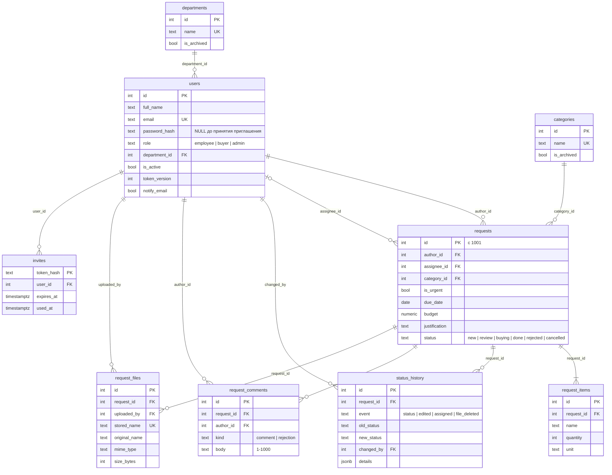

# Архитектура и правила системы

Технический документ. Цели, роли и сценарии — в [spec.md](spec.md). Любое правило ниже указывает файл, где оно проверяется, и тест, который его закрепляет. Пути даны от корня репозитория; `api.test.js` и `rules.test.js` лежат в `server/test/`.

Метки `BUG-NNN` в коде и в CHANGELOG относятся к аудиту; в таблице правил они сопоставлены номерам BR.

## 1. Схема данных

Девять таблиц. Миграции: `server/db/migrations/001_initial.sql`, `002_v1_1.sql`, `003_file_deleted_event.sql`.

Особенности:
- `requests.assignee_id`: `ON DELETE SET NULL`; позиции, история, комментарии и файлы удаляются вместе с заявкой (`ON DELETE CASCADE`).
- Комментарии неизменяемы на уровне БД: триггер `trg_comment_immutable` запрещает UPDATE и DELETE (кроме каскада при удалении заявки).
- В `invites` хранится только SHA-256 хэш токена, сам токен знает только получатель.

## 2. Бизнес-правила

| № | Правило | Где проверяется | Тест |
|---|---|---|---|
| BR-01 | Сотрудник видит только свои заявки; чужая заявка, её комментарии и файлы — 404 | `server/src/routes/requests.js`: `buildWhere`, `loadOne`, `visible` | api.test.js: «чужую заявку сотрудник не видит (404)», «сотрудник видит только свои заявки», «чужой сотрудник не может комментировать (404)», «9. сотрудник не может скачать файл чужой заявки…» |
| BR-02 | Статусы идут по цепочке `new → review → buying → done`; пропуск этапа недопустим (409) | `server/src/statuses.js` (`NEXT`, `canMove`); `PATCH /:id/status` | rules.test.js: «цепочка статусов и запрет пропуска этапов»; api.test.js: «цепочка статусов: пропуск этапа → 409» |
| BR-03 | Отклонить можно из `new`, `review`, `buying`; из `done`, `rejected`, `cancelled` переходов нет | `statuses.js`; `PATCH /:id/status` | rules.test.js: «из конечных статусов переходов нет» |
| BR-04 | Отклонение требует непустой комментарий в том же запросе | `server/src/schemas.js`: `statusPatchSchema` | rules.test.js: «F2: отклонение требует непустую причину…»; api.test.js: «2. отклонение без комментария…» |
| BR-05 | Закрытую заявку (`done`, `rejected`, `cancelled`) нельзя редактировать, назначать и менять в статусе; комментировать можно | `requests.js`: `isClosed` в `PUT /:id`, `/assign`, `/status` | api.test.js: «F3: закрытую заявку нельзя редактировать и менять; комментировать можно» |
| BR-06 | Менять статус могут только снабжение и админ | `server/src/auth.js`: `requireRole`; `PATCH /:id/status` | api.test.js: «сотрудник не может менять статус (403)» |
| BR-07 | Заявку с ответственным ведёт он сам: другой снабженец получает 403 «Заявку ведёт …» (админ — исключение) | `requests.js`: `PATCH /:id/status`, `POST /:id/assign` | api.test.js: «7. B3: другой снабженец не может сменить статус → 403» |
| BR-08 | Переход `new → review` без ответственного автоматически назначает выполнившего, в историю пишется событие `assigned` | `requests.js`: `autoAssign` в `PATCH /:id/status` | api.test.js: «B2: new → review автоматически назначает выполнившего…» |
| BR-09 | Снабженец не ведёт собственную заявку: ни сменой статуса, ни «Взять в работу», ни назначением через админа. Админ может вести свою | `requests.js`: `SELF_MSG` в `/status` и `/assign` | api.test.js: «BUG-003: снабженец не ведёт собственную заявку…», «админ не назначает снабженца ответственным за его же заявку…» |
| BR-10 | Ответственным можно назначить только активного снабженца или админа. Снабженец берёт только себя, назначать других и снимать ответственного может только админ | `requests.js`: `POST /:id/assign` | api.test.js: «B1: «Взять в работу»; чужую забрать нельзя, админ назначает любого снабженца» |
| BR-11 | Блокировка пользователя или перевод в `employee` снимает его с открытых заявок, в историю пишется событие `assigned` | `server/src/routes/misc.js`: `PATCH /api/users/:id` | api.test.js: «5b. блокировка и смена роли на employee снимают ответственного…» |
| BR-12 | Редактировать и отменять заявку может только автор и только в статусе `new`; изменение пишется в историю, пустое изменение не пишется | `requests.js`: `PUT /:id`, `POST /:id/cancel` | api.test.js: «4. правка владельцем попадает в историю (F4); без изменений — не пишется» |
| BR-13 | Комментарии только добавляются (API и БД), длина 1–1000, HTML хранится как текст | `schemas.js`: `commentSchema`; триггер в `002_v1_1.sql` | api.test.js: «3. комментарии только добавляются…», «на уровне БД комментарий нельзя изменить или удалить», «C4: длина 1–1000…» |
| BR-14 | Файл: только pdf, jpg, png, webp, xlsx, docx (по сигнатуре, расширение должно совпадать), до 10 МБ, не более 5 на заявку | `server/src/files.js`; `requests.js`: `POST /:id/files` | rules.test.js: «D1: определение типа файла по сигнатуре…»; api.test.js: «8. .exe, переименованный в .pdf…», «8. файл > 10 МБ…», «D1: не более 5 файлов на заявку…» |
| BR-15 | В закрытую заявку файлы не добавляются (проверка до чтения тела и повторно в транзакции) | `requests.js`: `guardUpload`, транзакция в `POST /:id/files` | api.test.js: «BUG-010: снабжение не прикрепляет файлы к закрытой заявке» |
| BR-16 | Файл удаляет его автор или админ, пока заявка не закрыта; в историю пишется событие `file_deleted` | `requests.js`: `DELETE /:id/files/:fileId`; миграция `003` | api.test.js: «D4: удалить может только автор файла…», «админ может удалить чужой файл; событие попадает в историю…» |
| BR-17 | Пароль: от 8 символов и не более 72 байт | `schemas.js`: `password` | rules.test.js: «регистрация и создание пользователя: пароль ≥ 8…»; api.test.js: «BUG-027: пароль длиннее 72 байт отклоняется…» |
| BR-18 | Лимиты неудачных входов: 10 за 15 минут на пару IP+email, 50 за 15 минут на IP, 30 за час на аккаунт независимо от IP (429) | `server/src/auth.js`: `createLimiters` | api.test.js: «12. подмена X-Forwarded-For…», «общий лимит 50 неудачных попыток на IP…», «BUG-029: лимит неудачных попыток на один аккаунт…» |
| BR-19 | Саморегистрация работает только при заданном `ALLOWED_EMAIL_DOMAIN`, только для адресов этого домена, роль всегда `employee`, 5 регистраций в час с IP. Несуществующее подразделение — 400 | `server/src/routes/auth.js`: `POST /register`; `createLimiters` | api.test.js: «A1: пока домен не задан, регистрация отключена», «5. регистрация вне ALLOWED_EMAIL_DOMAIN → 403», «регистрация с корпоративным адресом разрешена; роль всегда employee», «регистрация: 5 в час с IP, затем 429», «регистрация с несуществующим подразделением → 400» |
| BR-20 | Заблокированный пользователь получает 401 на следующем же запросе. Смена пароля, сброс пароля, «выйти везде» и блокировка гасят старые токены (`token_version`) | `auth.js`: `authenticate`; `routes/auth.js`; `routes/misc.js` | api.test.js: «6. после блокировки — 401…», «A4: смена пароля требует текущий…», «A5: сброс пароля…», «A6: «Выйти на всех устройствах»…» |
| BR-21 | Админ не блокирует себя, не снимает с себя роль админа, не сбрасывает себе пароль | `misc.js`: `PATCH /api/users/:id`, `POST /api/users/:id/reset-password` | api.test.js: «админ не снимает роль админа с себя…», «6. …сам себя админ не блокирует», «BUG-011: админ не может сбросить пароль самому себе» |
| BR-22 | Приглашение действует 72 часа, одноразовое, заблокированный пользователь его не принимает | `routes/auth.js`: `findInvite`, `accept-invite`; `misc.js` | api.test.js: «A2: приглашение — создание, письмо, принятие…», «A2: просроченное приглашение не принимается (72 ч)», «BUG-012: заблокированный пользователь не принимает приглашение…» |
| BR-23 | В архивную категорию или подразделение новые записи не привязываются | `requests.js`: `checkCategory`; `routes/auth.js` | api.test.js: «справочники: переименование и архивирование; архивная категория недоступна…» |
| BR-24 | Значения заявки: несуществующая дата и дата в прошлом (в `APP_TZ`) — 400, сумма 0…999 999 999 999,99 без молчаливого округления, 1–50 позиций, количество 1…1 000 000 | `schemas.js`: `requestSchema`; `requests.js`: `POST /`, `PUT /:id` | rules.test.js: «F1: несуществующие даты отклоняются», «заявка: позиции, количество, обоснование, дата»; api.test.js: «1. due_date 2026-02-31 → 400…», «дата в прошлом (в APP_TZ) → 400», «BUG-009: значения вне диапазона…» |
| BR-25 | Уведомления: смена статуса — автору; срочная заявка — всем снабженцам; комментарий автора — ответственному (без ответственного — всем снабженцам); комментарий снабжения — автору и ответственному; автору не пишем о его же действиях; сбой SMTP не ломает запрос | `requests.js`: `notifyUsers`; `server/src/mailer.js` | api.test.js: «10. смена статуса → письмо автору со ссылкой», «новая срочная заявка → всем снабженцам», «BUG-025: …» (два теста), «сбой SMTP не ломает основной запрос», «профиль: галочка уведомлений…» |
| BR-26 | Список: сотрудник видит свои по убыванию номера; снабжение — срочные и просроченные сверху, закрытые внизу; страница не более 100 записей; CSV выгружается потоком без лимита | `requests.js`: `ORDER_QUEUE`, `ORDER_OWN`, `streamCsv`; `schemas.js`: `listQuerySchema` | api.test.js: «B5: срочные и просроченные сверху, закрытые внизу», «11. 1 000+ заявок…», «11. CSV выгружает все записи…», «B4: фильтры…» |

## 3. Переходы статусов

Матрица хранится в двух местах: `server/src/statuses.js` (источник истины, проверяется сервером) и `client/src/constants.js` (копия для кнопок).

| Из | В | Кто может | Условие |
|---|---|---|---|
| (создание) | `new` | любая роль | валидные данные, активная категория (BR-23, BR-24) |
| `new` | `review` | снабжение, админ | не автор заявки, если не админ (BR-09); нет другого ответственного (BR-07). Без ответственного — автоназначение (BR-08) |
| `review` | `buying` | снабжение, админ | то же |
| `buying` | `done` | снабжение, админ | то же |
| `new`, `review`, `buying` | `rejected` | снабжение, админ | то же и обязательный комментарий (BR-04) |
| `new` | `cancelled` | только автор | отдельный маршрут `POST /:id/cancel` (BR-12) |
| `done`, `rejected`, `cancelled` | — | никто | заявка закрыта (BR-05) |

## 4. Права ролей

«Свои» — заявки, где пользователь автор.

| Действие | employee | buyer | admin |
|---|---|---|---|
| Создать заявку | да | да | да |
| Видеть заявки | только свои | все | все |
| Редактировать, отменять (только `new`) | свои | свои | свои |
| Менять статус | нет | чужие заявки | все |
| Взять заявку в работу | нет | чужую, без ответственного | любую |
| Назначить другого ответственного, снять ответственного | нет | нет | да (кроме снабженца-автора) |
| Комментировать | свои | все | все |
| Добавлять файлы | в свои | во все | во все |
| Удалять файлы | свои загрузки | свои загрузки | любые |
| Статистика, экспорт CSV | нет | да | да |
| Справочники (изменение) | нет | нет | да |
| Пользователи: создание, роли, блокировка, сброс пароля | нет | нет | да |
| Профиль, смена пароля, «выйти везде» | да | да | да |

Все закрытые заявки: редактировать, менять статус и добавлять и удалять файлы нельзя; комментировать можно.

## 5. Маршруты API

Все маршруты под `/api`. Кроме отмеченных «все», требуется `Authorization: Bearer <token>`. Ошибки: 400 неверные данные, 401 нет входа, 403 нет прав, 404 не найдено, 409 конфликт состояния, 429 лимит частоты.

| Метод | Маршрут | Роль | Описание |
|---|---|---|---|
| GET | `/health` | все | Проверка БД |
| GET | `/config` | все | Валюта, часовой пояс, признак регистрации |
| POST | `/auth/register` | все | Саморегистрация (BR-19) |
| POST | `/auth/login` | все | Вход, токен (BR-18) |
| GET | `/auth/me` | авторизованные | Текущий пользователь |
| PATCH | `/auth/me` | авторизованные | Имя, уведомления по почте |
| GET | `/auth/invite/:token` | все | Проверка ссылки-приглашения |
| POST | `/auth/accept-invite` | все | Принять приглашение, задать пароль |
| POST | `/auth/change-password` | авторизованные | Смена пароля |
| POST | `/auth/logout-all` | авторизованные | Завершить все сессии |
| GET | `/requests` | авторизованные | Список с фильтрами и пагинацией |
| GET | `/requests/export.csv` | buyer, admin | Выгрузка в CSV |
| POST | `/requests` | авторизованные | Создать заявку |
| GET | `/requests/:id` | автор, buyer, admin | Заявка с позициями, комментариями, историей, файлами |
| PUT | `/requests/:id` | автор | Изменить (только `new`) |
| POST | `/requests/:id/cancel` | автор | Отменить (только `new`) |
| POST | `/requests/:id/assign` | buyer, admin | Взять в работу или назначить (BR-09, BR-10) |
| PATCH | `/requests/:id/status` | buyer, admin | Сменить статус (раздел 3) |
| GET | `/requests/:id/comments` | автор, buyer, admin | Комментарии |
| POST | `/requests/:id/comments` | автор, buyer, admin | Добавить комментарий |
| POST | `/requests/:id/files` | автор, buyer, admin | Загрузить файл (BR-14, BR-15) |
| GET | `/requests/:id/files/:fileId` | автор, buyer, admin | Скачать файл |
| DELETE | `/requests/:id/files/:fileId` | загрузивший, admin | Удалить файл (BR-16) |
| GET | `/categories` | авторизованные | Активные категории |
| GET | `/departments` | все | Активные подразделения (нужны при регистрации) |
| GET | `/categories/all`, `/departments/all` | admin | Все, включая архивные |
| POST | `/categories`, `/departments` | admin | Добавить |
| PATCH | `/categories/:id`, `/departments/:id` | admin | Переименовать, архивировать |
| GET | `/users` | admin | Список пользователей |
| POST | `/users` | admin | Создать, выдать ссылку-приглашение |
| PATCH | `/users/:id` | admin | Роль, блокировка, подразделение, имя (BR-11, BR-21) |
| POST | `/users/:id/reset-password` | admin | Сбросить пароль, выдать ссылку |
| GET | `/stats` | buyer, admin | Счётчики по заявкам за период |

## 6. Известные ограничения

- Матрица статусов дублируется на сервере и клиенте; правила доступа к заявке реализованы в трёх функциях (`buildWhere`, `loadOne`, `visible`); `routes/requests.js` содержит маршруты, SQL и правила вместе. Вынос в слой сервисов запланирован отдельным шагом.
- Тесты правил с БД требуют PostgreSQL (`TEST_DATABASE_URL`) и в CI запускаются на сервисе PostgreSQL.
